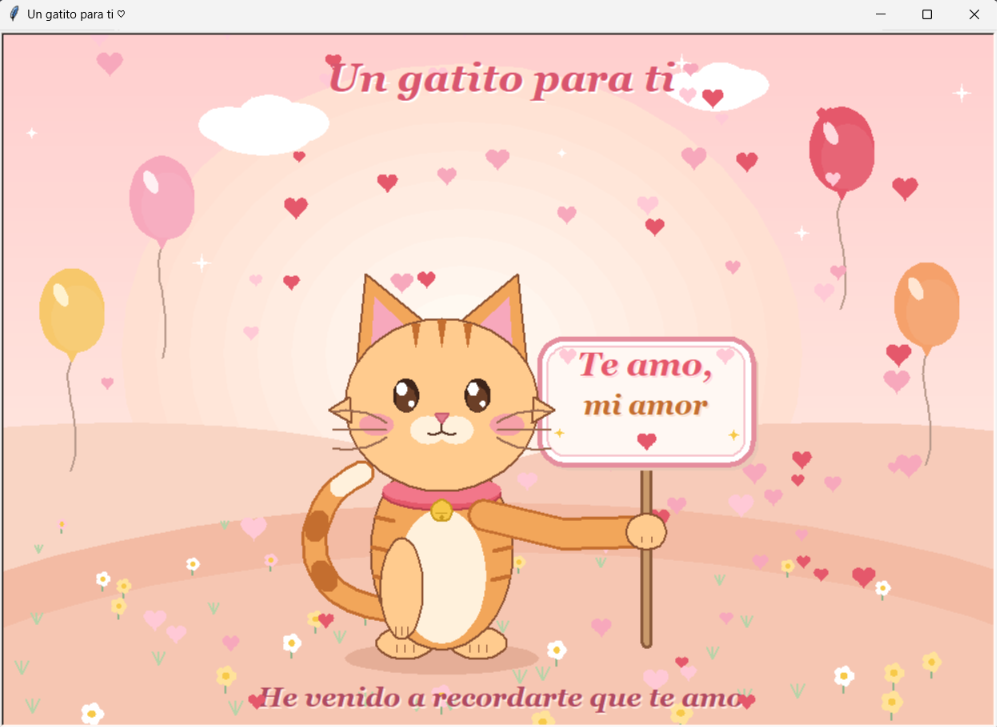

# 🐈 Cat with a Placard ♡

A little orange cat with a special message for someone very special: **Valbb**.

This project is part of a personal collection of small animations and creative coding experiments, created as little digital gifts for someone I love.

Using Python Turtle, I brought an adorable orange kitten to life. The little cat walks into the scene holding a romantic placard, surrounded by floating balloons, moving clouds, sparkling stars, and tiny hearts.

Because sometimes, even a little animated cat can say *I love you*. ♡

## ✨ Features

- 🐱 **Animated Cat:** An adorable light-orange kitten that walks into the scene.
- 💌 **Romantic Placard:** A decorated sign carrying a sweet message.
- 🎈 **Floating Balloons:** Pink, red, and orange balloons gently moving in the background.
- ☁️ **Animated Clouds:** Soft clouds drifting across the sky.
- 💗 **Heart Particles:** Little hearts floating around the scene.
- ⭐ **Sparkling Effects:** Animated stars and decorative details.
- 🌸 **Pastel Landscape:** A warm background with flowers, hills, and soft colors.
- 💕 **Final Message:** A special reminder of how much someone is loved.

## 🎨 Graphical Representation

The `graphical-representation` folder contains the visual preview and a video demonstration of the animation.

<p align="center">
  
</p>

<p align="center">
  <a href="graphical-representation/cat.mp4">▶ Watch the animation</a>
</p>

## 🛠️ Technologies Used

- Python 3
- Turtle Graphics
- Math
- Random
- Tkinter

## 🚀 How to Run

1. Make sure Python 3 is installed on your computer.
2. Clone this repository:

   ```bash
   git clone https://github.com/laetg404/cat-with-placard.git
   ```

3. Navigate to the project directory:

   ```bash
   cd cat-with-placard
   ```

4. Run the animation:

   ```bash
   python main.py
   ```

The animation window will open automatically.

## 📁 Project Structure

```text
cat-with-placard/
│
├── graphical-representation/
│   ├── cat.mp4
│   └── cat.png
│
├── main.py
└── README.md
```

## ♡ A Little Something for You

To my favorite person,

I wish I could wrap all my love into a little box and give it to you. Since I can't, I decided to put a little piece of it into something I could create myself.

A tiny cat, a little sign, some floating hearts, and a simple message that could never quite express everything I feel for you.

I hope that whenever you see this little creation, you remember that somewhere, someone is smiling just because you exist.

You are my favorite reason to create little things.

**Forever yours. ♡**

---

<sub>Part of a collection of little projects created with love.</sub>

🐈
